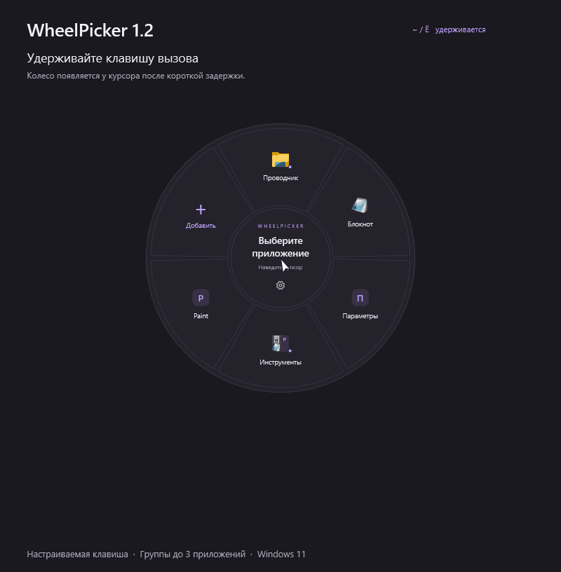
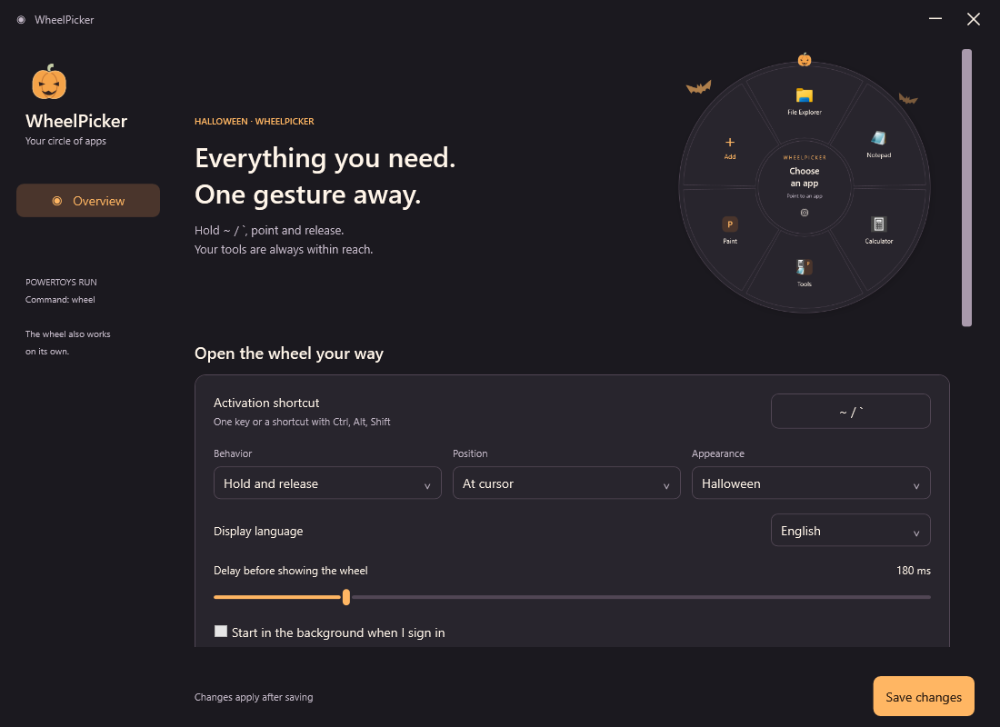

# WheelPicker

[Русский](README.md) · [English](README.en.md)

A radial application launcher for Windows 11, with optional PowerToys Run integration.



A 24-second tour of the current UI: app actions, groups, website icons, up to 10 commands typed without Enter, settings, and English/Halloween. The demo uses sample data; text insertion is illustrated in a sample input field.

## In development: create groups by dragging

In **Apps and groups**, drag a row by its icon, name, path, or empty space onto the center of another single item to open **Create group** with both selected items. Edit, delete, and arrow buttons retain normal click behavior. Choose its name and members, then select **Done**. The group replaces the target; other rows retain their order. Cancelling the editor leaves the original list unchanged; items excluded from the new group remain as singles. Select **Save changes** to apply the result to the wheel.

Apps, files, and links can share a group; two commands create a command group. Duplicates and nested groups are blocked. Dropping into existing groups or at row edges retains its previous behavior. The sidebar footer now shows only the version. These changes are available in source and local builds for the upcoming 1.6.2.

## Version 1.6.1: new app icon

A blue wheel with an outgoing app tile and arrow replaces the previous app, tray, installer, and PowerToys Run icon. Windows assets include transparent sizes from 16 to 256 px. General settings keeps its gear symbol; Wheel settings now uses a distinct segmented circle.

## Version 1.6.0: drag to add and wheel sizing

Start dragging a file, shortcut, or browser link, then invoke the wheel with its hotkey and release the mouse over **+**. In this mode the wheel appears over the source window without taking focus; you can release the hotkey before finishing the drag. A prefilled form opens: review the name and select **Add**. One item is accepted at a time, and the original file stays in place. Website shortcuts (`.url`) become regular web links with favicon support. Files and folders open through Windows.

You can also drop an item onto **+ Add** in **Apps and groups**, without a hotkey. Additions made in settings remain in the draft until saved.

Under **Wheel → Wheel size**, adjust the diameter (360–640), icon size, and text size (80–125%). A static preview and size reset are included. The wheel shrinks on smaller screens to fit outer actions; fork captions adjust to the available space. Preferences share the settings draft and import/export.

## Version 1.5.2: windows, undo and settings

The app offers three fork actions for running apps: **Switch to window**, **Open again**, and **Close**. Multiple windows can be chosen by title, and minimized windows are restored. Removing a wheel item or a group member offers **Undo** and **Ctrl+Z** until saving, discarding, or successfully importing a draft. Ctrl+Z in a text field keeps its normal editing behavior.

In the app editor, **Open again → Automatically / Allow / Hide** controls whether the repeat action is offered. Auto leaves only Switch and Close for Postman and retains all three actions for unknown apps. This is an overridable WheelPicker rule, not universal capability detection. Each entry keeps its own preference, including in backups.

### Settings sections

Settings now have four pages: **General**, **Apps and groups**, **Wheel**, and **Pet**. Apps, links, and commands share the Apps and groups page with a static wheel thumbnail. Wheel contains activation, delay, placement, and fork options. Pet offers animal selection, speed, and a live preview that reacts to hovering. General contains language, appearance, startup, and backups.

Edits remain in a shared draft when switching pages. **Save changes** and **Discard changes** stay at the bottom of the window, with an unsaved-change indicator and a nonmodal notification after saving.

## Version 1.5: command groups and pets

**1.5.1** adds two pixel pets on the inner ring: a ginger cat and a bat. Settings offer **Show animated pet**, **Match theme / Cat / Bat**, and speed from **0.25× to 3×**. The automatic choice is a bat for Halloween and a cat for other themes; either pet can be chosen in any theme. Hover to pause: the pet faces you, blinks, and displays a flashing yellow question mark, then resumes from the same spot. Preferences travel with backups; sprites are embedded in the EXE. [Sprites and prompts](assets/README.md).

A dedicated **Command group** holds up to **10 commands**, such as `.venv\Scripts\Activate.ps1`. Picking one types its text into the original active window **without Enter** and preserves your clipboard. Edit, reorder, drag commands into groups, and include them in settings backups. Duplicate commands and full groups show a notification; app groups still hold up to 3 apps.

## Version 1.4: website links and icons

Choose **Item type → Website link** in the add dialog to open Notion, Google Drive, or any web page in your default browser. Links support groups, drag and drop, and settings backups. Website icons load in the background and are cached locally; private pages can use a custom PNG, ICO or JPG.

## Version 1.3: English and Halloween

Russian and English interfaces and a **Halloween** theme with small vector pumpkins, bats, and warm accents on familiar Windows 11 surfaces.

In Settings, select **Display language → English** or **Appearance → Halloween**. Changes can be previewed immediately; select **Save changes** to apply them. Closing without saving restores the previous appearance. Your app names, launch commands, and group contents are preserved. Language and theme are included in settings export and import.

Language and appearance survive upgrades. See the [changelog](CHANGELOG.md).



## Install the stable release

Download **Setup.exe** from [Releases](../../releases) and run it. One file is enough; Git, a compiler, and internet access during installation are unnecessary. Requires Windows 11 x64 with .NET Framework 4.8. Installs for the current user without administrator rights. The installer is currently unsigned.

PowerToys is optional. If you install the PowerToys Run adapter, restart PowerToys afterward. It is built against PowerToys 0.101 / .NET 10.

## Use

- Hold **~ / `**, point at an app, and release. Configure another key or shortcut in Settings. Center and Esc cancel; click mode is also available.
- A dot indicates a running app. Outer actions open another instance or request that its windows close. File Explorer can open a new folder window or close all folder windows.
- Create groups of up to three apps. Drag existing entries into a group or add apps in the group editor. Duplicate members are rejected.
- Create a **Command group** for up to **10 commands**, such as `.venv\Scripts\Activate.ps1` or `git status`. Each command has a name and literal text. Picking it types into the field that was active before the wheel opened, **without Enter**, process execution, or changing the clipboard. Edit, reorder, drag existing commands into a group, and include them in settings backups. Duplicate entries and full groups show a notification. App groups still allow up to three apps.
- Choose installed desktop or Microsoft Store apps, or browse to a file or shortcut.
- Select **Item type → Website link** in the add dialog to add Notion, Google Drive, or any specific web page. Addresses without a scheme receive `https://`; a blank name uses the website domain. Links open in your default browser and support groups and settings export.
- Website icons load in the background and are cached locally. In the link editor, choose a custom PNG, ICO or JPG, or return to Automatic. Custom icons are included in settings backups and are useful for private Notion pages whose icon requires sign-in. WheelPicker does not use browser passwords or cookies.
- Configure delay, placement, appearance, and action selection padding. Reorder entries by dragging; export and import settings.
- PowerToys Run commands: **wheel** and **wheel settings**.

Closing sends a normal window-close request, allowing an app to ask you to save work. WheelPicker never forcibly terminates your applications.

## Build and test

See [DEVELOPMENT.md](DEVELOPMENT.md) for source layout, isolated chats and worktrees, checks, and releases. Shared Codex instructions are in [AGENTS.md](AGENTS.md); both development guides are currently in Russian.

The C# / WPF project uses the built-in Windows .NET Framework compiler. No .NET SDK or third-party runtime packages are required.

```powershell
.\Build.ps1 -SkipPlugin
.\Test.ps1

# Optional adapter, using an installed copy of PowerToys:
.\Build.ps1 -PowerToysPath (Join-Path $env:LOCALAPPDATA 'PowerToys')

# Installer, requiring Inno Setup 6.7.3 or newer:
.\Build-Setup.ps1 -CompilerPath 'C:\Tools\Inno Setup 6\ISCC.exe'
```

Settings live in `%LOCALAPPDATA%\WheelPicker` and survive upgrades and uninstalling. For an isolated development session, run `WheelPicker.exe --settings --data-dir C:\Temp\WheelPicker-Preview`; choose an unused shortcut for that session.

[MIT license](LICENSE.txt). This is a community project, not an official Microsoft module.
